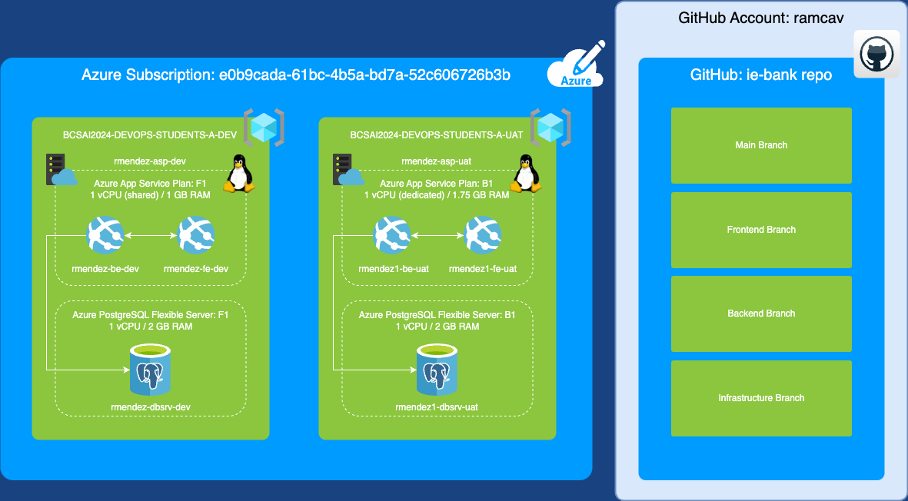

# IE Bank

IE Bank is a full-stack web application that simulates a simple online banking
experience. It is organized as a monorepo with three independently deployable
components: a Flask backend, a Vue.js frontend, and Azure Bicep infrastructure
as code.

- [IE Bank](#ie-bank)
  - [Architecture](#architecture)
  - [Repository structure](#repository-structure)
  - [Technology stack](#technology-stack)
  - [Getting started](#getting-started)
  - [Continuous delivery](#continuous-delivery)
  - [Documentation](#documentation)

## Architecture

The application follows a classic three-tier architecture:

- **Presentation tier** — Vue.js single-page application served by Azure App
  Service.
- **Application tier** — Flask REST API served by Azure App Service.
- **Data tier** — Azure Database for PostgreSQL Flexible Server (SQLite is used
  locally and in CI).

## Repository structure

| Path | Description |
| --- | --- |
| [`backend/`](backend) | Flask REST API that exposes the banking endpoints. See [`backend/README.md`](backend/README.md). |
| [`frontend/`](frontend) | Vue.js SPA that consumes the backend API. See [`frontend/README.md`](frontend/README.md). |
| [`infrastructure/`](infrastructure) | Azure Bicep templates that provision all cloud resources. See [`infrastructure/README.md`](infrastructure/README.md). |
| [`.github/workflows/`](.github/workflows) | GitHub Actions pipelines for the backend, frontend, and infrastructure. |

## Technology stack

| Layer | Technologies |
| --- | --- |
| Frontend | Vue.js, Node.js 18, npm |
| Backend | Python 3.11, Flask, Flask-SQLAlchemy, Flask-CORS |
| Database | PostgreSQL (cloud), SQLite (local / CI) |
| Infrastructure | Azure App Service, Azure Database for PostgreSQL Flexible Server, Azure Bicep |
| CI/CD | GitHub Actions |

## Getting started

Each component has its own setup instructions; follow them in the order below
to run the full stack locally.

1. **Backend** — set up a Python virtual environment and run the Flask app.
   See [`backend/README.md`](backend/README.md).
2. **Frontend** — install Node dependencies and start the Vue dev server.
   See [`frontend/README.md`](frontend/README.md).
3. **Infrastructure** — install the Azure CLI and deploy the Bicep templates to
   provision cloud resources. See [`infrastructure/README.md`](infrastructure/README.md).

## Continuous delivery

Three GitHub Actions workflows deliver the application to Azure:

| Workflow | Purpose |
| --- | --- |
| [`ie-bank-backend.yml`](.github/workflows/ie-bank-backend.yml) | Builds, tests, and deploys the Flask backend to Azure App Service. |
| [`ie-bank-frontend.yml`](.github/workflows/ie-bank-frontend.yml) | Builds and deploys the Vue frontend to Azure App Service. |
| [`ie-bank-infra.yml`](.github/workflows/ie-bank-infra.yml) | Deploys the Bicep infrastructure to Azure. |

All workflows authenticate to Azure using the `AZURE_CREDENTIALS` GitHub
secret. Database credentials and environment configuration are passed through
additional secrets and variables documented in each component's README.

## Documentation

Additional diagrams are available at the repository root:

- [Architecture diagram](DIAGRAM_ARCHI.drawio.png)
- [GitHub workflow diagram](GITHUB.drawio.png)
- [Data flow diagram](data_flow_diagram.drawio.png)
- Use case diagrams: [1](use_case_1.drawio.png), [2](use_case_2.drawio.png),
  [3](use_case_3.drawio.png), [4](use_case_4.drawio.png),
  [5](use_case_5.drawio.png)
